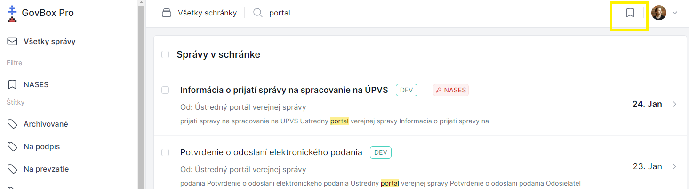
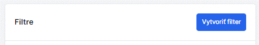
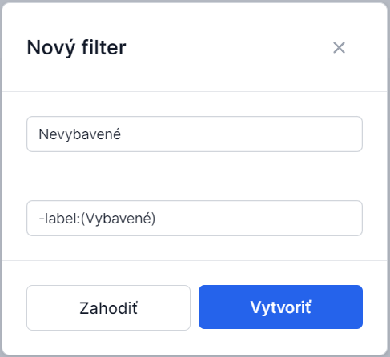
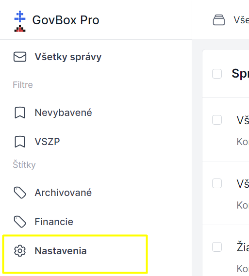

# Vytvorenie vlastného filtra

Filter je dopyt vyhľadávania uložený spoločne s názvom na neskoršie využitie.

::: callout tip "Praktický príklad"
> Vytvorím filter "Nevybavené", kde sa budem dopytovať na všetky správy, ktoré nemajú štítok "Vybavené". Zobrazenie tohto filtra zabezpeční prehľad agendy, ktorá vyžaduje riešenie či odpoveď.
> 
> Dopyt: `-label:(Vybavené)`
:::

## Spôsob vytvorenia filtra

::: tabs

== tab "Z poľa vyhľadávania"

1. **Zadajte dopyt**
   Filter nastavíte priamo po zadaní dopytu do poľa vo vrchnej časti obrazovky

2. **Vyhľadajte správy**
   Po vyhľadaní správ máte k dispozícii v pravej časti obrazovky ikonu filtra

3. **Uložte filter**
   Kliknutím na ikonu filtra ponúka možnosť uloženia dopytu vo forme filtra

4. **Vytvorte filter**
   V pravom hornom rohu sa nachádza modré tlačidlo **"Vytvoriť filter"**

5. **Vyplňte údaje**
   V okne **"Nový filter"**:
   - Pole pre **názov** filtra
   - Pole pre **dopyt** na vyhľadávanie
   - Tlačidlo **"Zahodiť"**
   - Tlačidlo **"Vytvoriť"**

6. **Použite operátor negácie**
   Dopyt na negáciu môžete zadať použitím **mínus** (napr. `-label:(Vybavené)`)

== tab "Z bočného menu"

1. **Otvorte nastavenia**
   V ľavom bočnom menu sa nachádzajú filtre, štítky a ikona pre nastavenie
   Kliknite na nastavenie

2. **Otvorte filtre**
   Zobrazí sa okno s názvom **"Filtre"**

3. **Vytvorte nový filter**
   V pravom rohu kliknite na **"Vytvoriť filter"**

4. **Zadajte údaje**
   Zadajte názov a dopyt na vyhľadávanie

:::

## Moje menu

V **Nastavenia → Moje menu** si vyberáte jediný zdroj položiek bočného menu.
Hore sú **Zobrazené v menu**, ktoré môžete zoradiť šípkami alebo **Skryť**.
Dole sú **Nezobrazené položky**; cez **Zobraziť v menu** ich pridáte na koniec.
Prvá zobrazená položka určuje úvodné vyhľadávanie v schránke.

Na výber sú osobné a spoločné filtre, **Všetky správy** aj filtre všetkých
štítkov vrátane skrytých a systémových. Osobné štítky patria iba ich vlastníkovi.
Nové filtre a nové štítky sa do menu nezapínajú automaticky. Pri prvom otvorení
Moje menu sa doplní katalóg filtrov existujúcich štítkov bez zmeny vašich volieb.
Menu nemá ďalšie automatické rýchle odkazy.

**Skrytie nevypína notifikácie.** V **Nastavenia → Filtre** zostáva dostupná
správa uložených vyhľadávaní a odberov aj pre nezobrazené filtre. Zrušenie
vyhľadávania zobrazí všetky dostupné správy bez opätovného použitia predvoľby.

**Filter** je uložené vyhľadávanie. **Štítok** označuje správu. V časti **Filtre**
spravujete uložené vyhľadávania; v časti **Moje menu** si vyberáte, ktoré z nich
sa zobrazia v bočnom menu a v akom poradí. Toto nastavenie nemení štítky na
správach ani odbery notifikácií.

## Spoločné filtre pre administrátora

Pri vytváraní filtra môže administrátor zvoliť **Spoločný filter pre všetkých**.
Nový spoločný filter pribudne medzi nezobrazené položky v **Moje menu**. Existujúci
osobný filter s rovnakým dopytom má prednosť, aj keď je odopnutý. Spoločný názov
a dopyt spravuje administrátor; používatelia menia iba vlastné pripnutie, poradie
a notifikácie.

Pri zmene dopytu spoločného filtra sa najprv zobrazí pôvodný a nový dopyt a
upozornenie na zmenu výsledkov aj existujúcich odberov. Až **Potvrdiť zmenu
dopytu** zmenu uloží. **Zrušiť** nechá pôvodné podmienky nezmenené. Pripnutia,
poradie a existujúce odbery zostávajú zachované.

Pred odstránením spoločného filtra administrátor uvidí počet používateľov s
odberom a upozornenie, že sa ich odbery zrušia. Po potvrdení **Odstrániť filter**
zmizne spoločná definícia aj jej odbery; nevytvoria sa osobné kópie. Osobné
duplikáty, správy a štítky zostanú nezmenené. Starý query odkaz stále funguje
ako obyčajné vyhľadávanie.

## Operátory pre vyhľadávanie

| Operátor | Popis | Príklad |
|----------|-------|---------|
| `label:(Názov)` | Vyhľadanie vlákien so štítkom | `label:(Test)` |
| `-label:(Názov)` | Vyhľadanie vlákien bez štítku | `-label:(Test)` |
| `-label:(*)` | Vyhľadanie vlákien úplne bez štítkov | `-label:(*)` |

## Súvisiace témy

### Notifikácie
Nastavte si upozornenia na správy vyhovujúce filtrom.

- **[Nastavenie notifikácií](/notifications/setting-up)**

### Filter (pojem)
Čo je filter a ako funguje.

- **[Filter (pojem)](/concepts/filter)**
