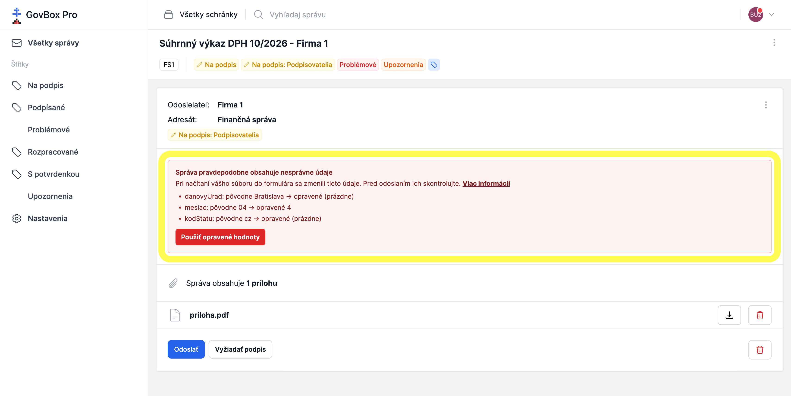
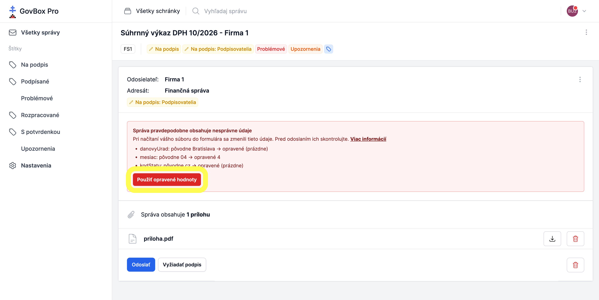

# Zmenené údaje vo formulári Finančnej správy
Pri kontrole podania GovBox PRO načíta váš XML súbor do formulára Finančnej správy, rovnako ako keby ste ho nahrali na portáli Finančnej správy. Formulár niekedy niektoré údaje zmení, napríklad IČO, DIČ, IČ DPH alebo sumu, prípadne pole vyprázdni. GovBox PRO vás na takéto zmeny upozorní, aby ste ich mohli pred odoslaním skontrolovať.

::: callout info "Podanie môžete odoslať"
Upozornenie odoslanie neblokuje. Ak podanie odošlete bez zmeny, odošle sa s údajmi z vášho pôvodného súboru.
:::

## Ako spoznáte podanie so zmenenými údajmi
1. **Štítky Problémové a Upozornenia**
   GovBox PRO označí podanie štítkami **"Problémové"** a **"Upozornenia"**, takže ho rýchlo nájdete pomocou filtra **Problémové**

2. **Zoznam zmien v detaile podania**
   Po otvorení podania sa zobrazí rámik **"Správa pravdepodobne obsahuje nesprávne údaje"** so zoznamom zmien v tvare *pole: pôvodne X → opravené Y*. Pole, ktoré formulár vyprázdnil, je označené ako *(prázdne)*

   

## Postup kontroly zmenených údajov
1. **Skontrolujte zmeny**
   Používateľ porovná pôvodné a opravené hodnoty v rámiku so svojimi podkladmi

2. **Použite opravené hodnoty, ak sú správne**
   Používateľ klikne na tlačidlo **"Použiť opravené hodnoty"** a potvrdí výzvu. Údaje vo formulári sa nahradia opravenými a podanie sa znovu automaticky skontroluje

   

3. **Alebo opravte pôvodný súbor**
   Ak opravené hodnoty nie sú správne, používateľ opraví údaje vo svojom účtovnom programe, vytvorí nový XML súbor a nahrá ho znova, viď [Hromadné podania](submissions.md)

::: callout warning "Upozornenie"
Po kliknutí na **"Použiť opravené hodnoty"** sa pôvodné údaje nedajú vrátiť späť, iba opätovným nahratím súboru. Ak je pri niektorom poli uvedené *(prázdne)*, po použití opravených hodnôt bude toto pole v podaní prázdne.
:::

Tlačidlo **"Použiť opravené hodnoty"** sa nezobrazí, ak je podanie už podpísané alebo ak opravený formulár nie je k dispozícii. V takom prípade opravte pôvodný súbor a nahrajte ho znova.

## Pre používateľov API
Zmenené údaje nájdete v metaúdajoch rozpracovanej správy v poli `validation_errors.diff_errors`. Každá položka je výstup príkazu `diff`, kde `<` označuje pôvodnú a `>` opravenú hodnotu. Samotné zmenené údaje stav správy nemenia a správu je možné odoslať. Popis poľa nájdete v [OpenAPI špecifikácii](https://pro.govbox.sk/openapi.yaml).

## Súvisiace témy

### Hromadné podania
Ako hromadne podávať na Finančnú správu v GovBox PRO:

- **[Hromadné podania](submissions.md)**

### Odosielanie správ
Ako odoslať rozpracované správy v GovBox PRO:

- **[Odosielanie správ](../messages/submitting.md)**
