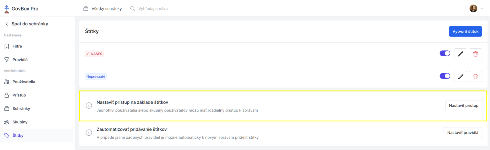
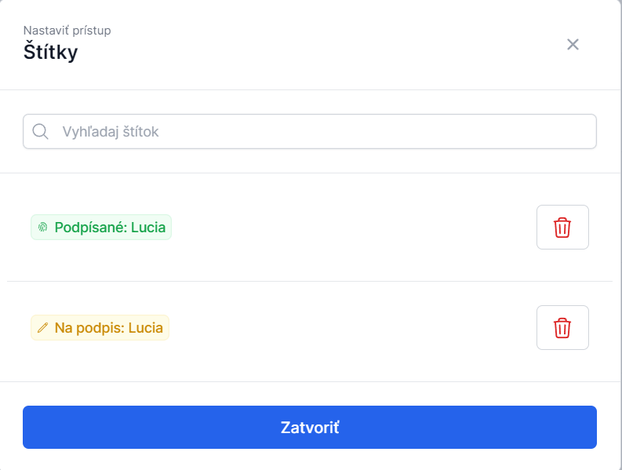

# Prístup k štítkom

Prístup k štítkom umožňuje administrátorom kontrolovať, ktorí používatelia alebo skupiny majú prístup k vláknam označeným konkrétnym štítkom.

::: callout info "Výhody"
Toto je ideálny spôsob, ako zabezpečiť, že napríklad zamestnanci účtovného oddelenia budú vidieť len správy týkajúce sa financií.
:::

## Postup nastavenia prístupu

1. **Otvorte Nastavenia**
   Kliknite na **"Nastavenia"** v ľavom menu dole

2. **Prejdite do sekcie Štítky**
   V sekcii **"Administrácia"** kliknite na možnosť **"Štítky"**

3. **Zobrazí sa prehľad štítkov**
   Zobrazia sa vytvorené štítky a sekcia **"Nastaviť prístup na základe štítkov"**

4. **Nastavte prístup**
   Kliknite na **"Nastaviť prístup"** v príslušnom riadku

5. **Upravte oprávnenia skupiny**
   V nastaveniach sa riadi príslušnosť k skupinám
   Kliknutím na ikonu pera v danom riadku skupiny máte možnosť skupine pridať alebo odobrať prístup k štítku

## Kto môže meniť prístupové štítky

::: callout warning "Zmena toho, kto vidí správy"
Prístupové štítky určujú, ktoré skupiny používateľov môžu vidieť správy vo vlákne, ak majú aj prístup k jeho schránke. Ich pridaním alebo odobratím teda meníte, kto bude mať k správam prístup. Toto oprávnenie udeľujte iba používateľom, ktorí majú rozhodovať o rozdeľovaní pošty.
:::

Administrátor oprávnenie udeľuje skupine cez **Nastavenia → Prístup → úprava oprávnení skupiny**, prepínačom **„Oprávnenie spravovať prístupové štítky“**. **Novovytvorené skupiny ho štandardne nemajú.** Výnimkou je administrátorská skupina, ktorá ho má vždy povolené.

Samotné oprávnenie používateľovi nesprístupní ďalšie správy. Umožní mu meniť prístupové štítky na vláknach, ktoré už môže vidieť.

Používateľ má oprávnenie, ak ho udeľuje aspoň jedna jeho skupina. Pri odobratí preto skontrolujte, či mu ho neudeľuje ešte iná skupina.

## Príklady použitia

### Príklad: Sociálna poisťovňa
> Vytvorím štítok **"Sociálna poisťovňa"** s pravidlom, že správy prichádzajúce a odchádzajúce do Sociálnej poisťovne budú takto označované. Ekonomickému oddeleniu vo firme udelím prístup na zobrazenie správ s týmto štítkom. Iné správy osobám s týmto oprávnením zobrazené nebudú.

### Príklad: Prístup k financiám
> Ekonomickému oddeleniu udelím prístup k správam so štítkom **"Financie"**.

### Príklad: Triedič pošty
> Skupine **"Triediči pošty"** udelím oprávnenie spravovať prístupové štítky. Jej členovia môžu dostupným vláknam priradiť štítok **"Financie"** alebo **"Právne"** a sprístupniť ich príslušným skupinám. Skupinám používateľov, ktorí iba vybavujú pridelené správy, toto oprávnenie neudelím.
