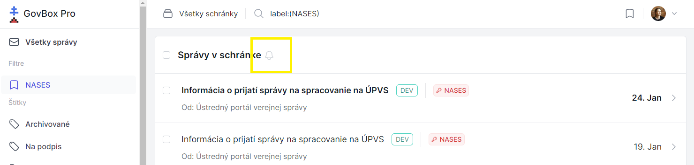
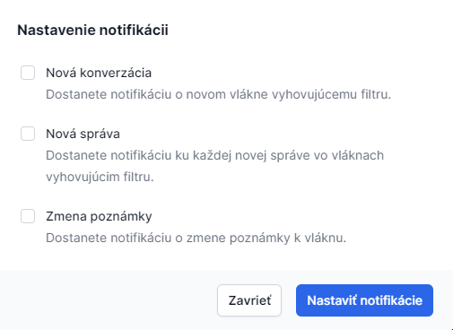

# Nastavenie notifikácií

Notifikácie sú upozornením na aktivitu v schránke. GovBox Pro ponúka možnosti nastavenia notifikácií upozorňujúcich na nové správy, zmeny vlákna či štítku.

::: callout info "Predpoklady"
Notifikácie je možné nastaviť na udalosti týkajúce sa správ a vlákien, ktoré spĺňajú podmienky už vytvoreného filtra.
:::

## Postup nastavenia notifikácie

1. **Zvoľte filter**
   Používateľ zvolí v ľavom menu žiadaný filter

2. **Otvorte nastavenia notifikácií**
   Kliknutím na ikonu zvončeka sa otvorí okno s možnosťami nastavenia notifikácií

3. **Zvoľte udalosti**
   Používateľ zvolí, na aké udalosti chce byť notifikovaný

4. **Uložte nastavenia**
   Klikne na tlačidlo **"Nastaviť notifikácie"**

::: callout warning "Dôležité"
Notifikácie sa budú týkať iba správ, ktoré spĺňajú podmienky vybraného filtra.
Spoločný filter neprideľuje prístup k správam. Výsledky aj notifikácie rešpektujú
vaše oprávnenia ku schránkam a správam; preto môže rovnaký filter každému ukazovať
iný počet správ alebo žiadne správy.
:::

## Prístup k notifikáciám

### Kde nájsť notifikácie
Notifikácie sú k dispozícii po kliknutí na ikonu používateľa v pravom hornom menu a voľbe **"Notifikácie"**.

Odopnutie filtra z menu nevypne jeho odber. Nájdete ho aj s nastavením odberu
v **Nastavenia → Filtre** alebo otvorením jeho vyhľadávacieho dopytu. Ak rovnaký
dopyt máte uložený osobne, stránka môže mať osobný názov, ale existujúci spoločný
odber na nej stále môžete upraviť alebo vypnúť.

Odkaz na filter v notifikácii otvorí jeho aktuálny dopyt a filter automaticky
nepripne. Po zmene spoločného dopytu administrátorom sa aj staré odkazy otvoria
s novými podmienkami. Priame odkazy na správu alebo vlákno sa nemenia.
Už pripravené upozornenie môže výnimočne zodpovedať podmienkam pred zmenou dopytu;
historické verzie filtrov a rušenie čakajúcich upozornení sa nevedú.
